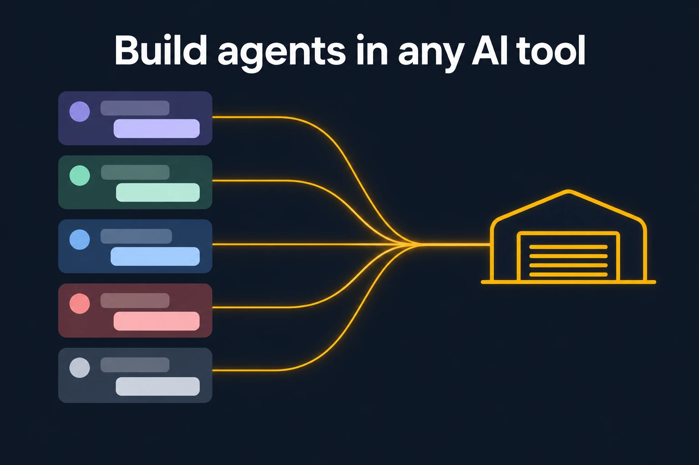
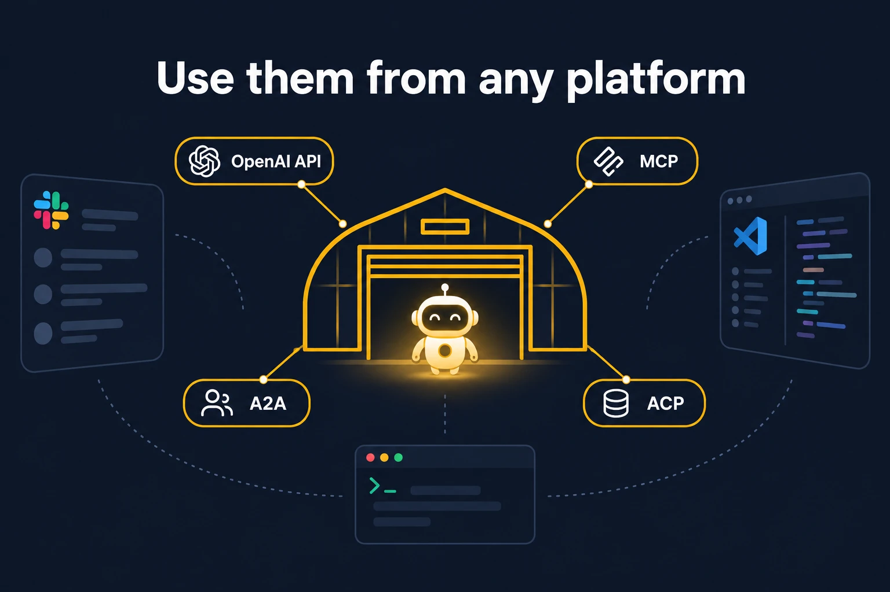
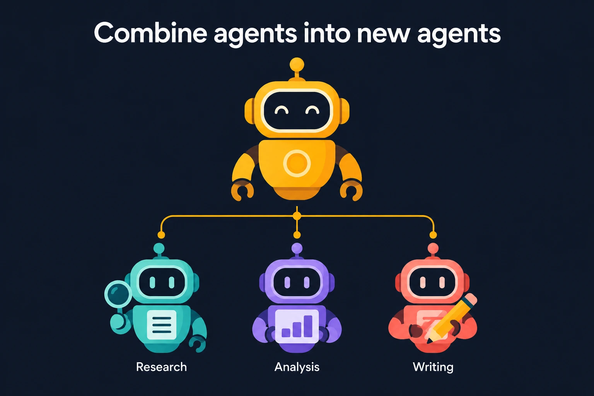
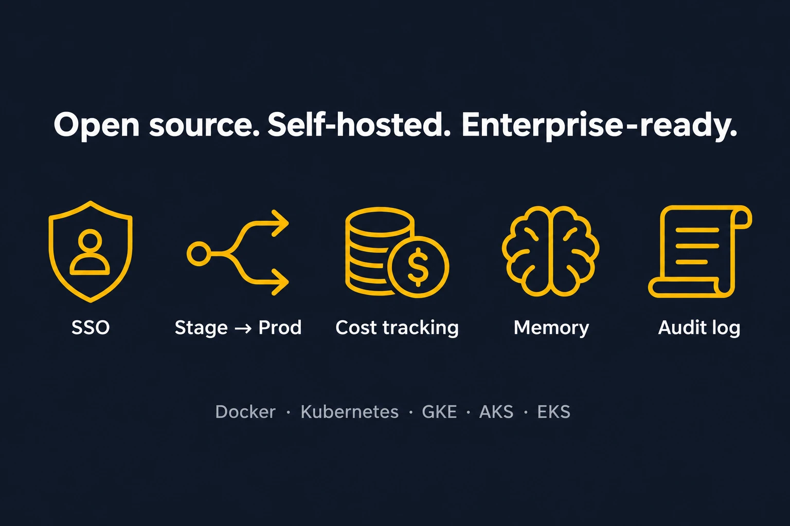

<p align="center">
  
</p>

<h1 align="center">HangarLLM</h1>

<p align="center"><b>One home for every AI model and agent.</b><br>
An open-source LLM gateway, Python SDK and admin UI. Route, govern and observe every LLM, MCP server and agent from a single place.</p>

<p align="center">
  <a href="LICENSE"></a>
  
  
</p>

<p align="center">
  <a href="#quick-start">Quick start</a> ·
  <a href="#features">Features</a> ·
  <a href="#calling-the-gateway">Calling the gateway</a> ·
  <a href="#decisions-models">Decisions</a> ·
  <a href="#skills-hub-git-sync">Skills Git Sync</a> ·
  <a href="#security">Security</a> ·
  <a href="#troubleshooting">Troubleshooting</a>
</p>

## What is HangarLLM

HangarLLM is a gateway that sits between your applications and every model or agent they use. Teams point their OpenAI, Anthropic or MCP clients at one URL, and HangarLLM handles authentication, routing, retries, fallbacks, spend tracking, rate limits, guardrails and audit logs. Admins run all of it from a web dashboard.

Everything here is open source under the MIT License, with no license key, no seat limit and no call to a license server. The project builds on MIT licensed work credited in [NOTICE](NOTICE).

```text
 Your apps, IDEs and agents
 OpenAI SDK, Anthropic SDK, MCP, A2A
              |
              v
 +------------------------------------------+
 |  TLS proxy (Caddy)                       |
 +------------------------------------------+
 |  HangarLLM gateway and admin UI          |
 |  keys, budgets, routing, guardrails,     |
 |  logging, Skills Hub, Decisions          |
 +------------------------------------------+
    |            |              |
 Postgres      Redis       Prometheus
              |
              v
 100+ model providers, MCP servers and agents
```

<p align="center">
  
  
</p>

## Features

**Models and protocols.** One OpenAI-compatible API for 100+ providers, including OpenAI, Anthropic, Azure, Bedrock, Vertex AI, Gemini, Mistral, Groq, DeepSeek, Ollama and vLLM. It covers chat completions, the Responses API, Anthropic Messages, embeddings, images, audio, batches, rerank, OCR and Decisions, along with an MCP gateway and A2A agent endpoints.

**Routing and reliability.** Load balancing across deployments, retries, fallbacks, cooldowns, latency and cost based routing, an auto router that picks a model per prompt, and shared state over Redis for multi-instance deployments.

**Access and governance.** Virtual keys, teams, organizations, projects, customers, budgets per key and per team, TPM and RPM limits, IP allow lists and model access groups.

**Enterprise capabilities, open to everyone.**

| Capability | What you get |
| --- | --- |
| SSO | Google, Microsoft, Okta and any OIDC or SAML provider for the admin UI, custom SSO handlers and JWT auth |
| Audit log | Who changed which key, team, model or setting and when, from the API and the UI |
| Guardrails | Secret detection, banned keywords, blocked users, OpenAI and Google moderation, Llama Guard, LLM Guard, PII masking and custom guardrails per key or team |
| Alerts | Email through SMTP, SendGrid or Resend, PagerDuty incidents, and Slack or webhook alerts |
| Cost tracking | Spend per key, user, team, tag and model, including batch and Responses API jobs, with Prometheus metrics |
| Managed resources | Managed files and vector stores behind the gateway |
| Secret managers | AWS Secrets Manager and KMS, Azure Key Vault, Google Secret Manager, HashiCorp Vault and CyberArk |
| Branding | Custom logo, colors and docs title for the admin UI |

**Built for HangarLLM.** Sync agent skills from your GitHub repositories, choose and extend Decisions wire formats per model, and run a stack that keeps keys out of the browser, as described below.

<p align="center">
  
  
</p>

## Quick start

You need Git, Docker with Compose, and Python 3 to generate the secrets. The first build compiles a Rust extension, so it can take 15 minutes or more. No prebuilt image is published yet.

Clone the repository.

```bash
git clone https://github.com/valteresj2/HangarLLM.git
```

```bash
cd HangarLLM
```

Generate the secrets. This creates one random value per file under `secrets/`, which Git ignores. Running it again keeps existing values.

```bash
python scripts/hangar_init_secrets.py
```

Build and start the stack, which runs the TLS proxy, gateway, Postgres, Redis and Prometheus.

```bash
docker compose up -d --build
```

Open **https://localhost/ui**. Sign in as `admin` with the password stored in `secrets/ui_password`.

On localhost the certificate comes from a private CA that Caddy creates, so the browser shows a warning the first time. You can continue past it, or trust the CA once. Export it with the command below, then add the file to your operating system's trusted roots.

```bash
docker compose cp proxy:/data/caddy/pki/authorities/local/root.crt ./secrets/hangar-local-ca.crt
```

If port 443 is taken, set another one before starting, for example `HANGARLLM_PORT=4400` in `.env`, and open `https://localhost:4400/ui`. For a public domain, set `HANGARLLM_DOMAIN` to the host name and `HANGARLLM_TLS` to your email address, and Caddy requests a real certificate.

Back up `secrets/salt_key`. Losing or changing it makes the provider credentials stored in the database unreadable.

## Calling the gateway

Add a model under **Models + Endpoints** in the UI, create a key under **Virtual Keys**, and call the gateway with any OpenAI client.

```python
import openai

client = openai.OpenAI(api_key="sk-your-virtual-key", base_url="https://localhost")
response = client.chat.completions.create(
    model="my-model",
    messages=[{"role": "user", "content": "Hello from the hangar"}],
)
print(response.choices[0].message.content)
```

With the local certificate, point your client at the exported CA, for example `SSL_CERT_FILE=secrets/hangar-local-ca.crt`, or trust the CA system-wide.

The same call with curl:

```bash
curl --cacert secrets/hangar-local-ca.crt https://localhost/v1/chat/completions -H "Authorization: Bearer sk-your-virtual-key" -H "Content-Type: application/json" -d '{"model": "my-model", "messages": [{"role": "user", "content": "Hello"}]}'
```

### Python SDK

The SDK can also call providers directly, without a gateway. Installing from source needs the [Rust toolchain](https://rustup.rs), because part of the request path is a native extension.

```bash
pip install "hangarllm @ git+https://github.com/valteresj2/HangarLLM.git"
```

```python
import hangarllm

response = hangarllm.completion(
    model="anthropic/claude-sonnet-4-5",
    messages=[{"role": "user", "content": "Hello!"}],
)
```

## Configuration

Compose reads optional settings from `.env`, and gateway settings go in [docker/hangarllm-config.yaml](docker/hangarllm-config.yaml), which is the place to list models, callbacks and router options.

| Variable | Purpose |
| --- | --- |
| `HANGARLLM_MASTER_KEY` | Admin key for the API. It is not accepted as a UI password |
| `HANGARLLM_SALT_KEY` | Encrypts provider credentials stored in the database |
| `UI_PASSWORD`, `UI_USERNAME` | Admin UI login. The username defaults to `admin` |
| `HANGARLLM_UI_SESSION_SECRET` | Signs UI sessions. Derived from the salt key when unset |
| `DATABASE_URL` | Postgres connection string for keys, teams, spend and audit logs |
| `REDIS_HOST`, `REDIS_PORT`, `REDIS_PASSWORD` | Shared cache, rate limits and router state |
| `HANGARLLM_METRICS_TOKEN` | Bearer token that may only scrape `/metrics` |
| `HANGARLLM_PORT` | Host port of the TLS proxy in Compose. Defaults to 443 |
| `HANGARLLM_DOMAIN`, `HANGARLLM_TLS` | Public host name and the ACME email for its certificate |
| `HANGARLLM_LOCAL_MODEL_COST_MAP` | The bundled price map is used at startup. Set it to `false` to fetch the latest map instead |
| `HANGARLLM_POLICY_TEMPLATES_URL` | Optional remote catalog of guardrail policy templates |
| `HANGARLLM_DISABLED_FEATURES` | Comma separated features to switch off |
| `HANGARLLM_SKILL_SANDBOX_NETWORK` | Set to `true` to give skill code network access |
| `HANGARLLM_LEAK_REPORT_SECRET` | Enables `/key/leak-report` and verifies its signature |
| `HANGARLLM_KMS_PROVIDER`, `HANGARLLM_KMS_KEY_ID`, `HANGARLLM_SALT_KEY_WRAPPED` | Envelope encryption of the salt key with AWS, Google Cloud or Vault |
| `HANGARLLM_DISABLE_KEY_POLICY` | Set to `true` to allow keys without expiry, budget or models |
| `HANGARLLM_DISABLE_SECRET_GUARDRAIL` | Set to `true` to stop masking provider keys in prompts |
| `HANGARLLM_DISABLE_SKILL_GIT_SYNC` | Set to `true` to stop polling GitHub skill repositories |
| `HANGARLLM_ALLOW_MASTER_KEY_UI_LOGIN` | Set to `true` to accept the master key as UI password |
| `HANGARLLM_ALLOW_SHARED_SECRETS` | Set to `true` to start when secrets are reused, while migrating an existing database |

Master key, salt key, session secret, metrics token, `UI_PASSWORD`, `DATABASE_URL` and `REDIS_PASSWORD` can each be read from a file by adding the `_FILE` suffix, which is how the Compose stack passes them as Docker secrets.

## Decisions models

`POST /v1/decisions` accepts the [OpenAI Decisions format](https://developers.openai.com/api/docs/guides/decisions) for every provider. A request asks typed questions about shared input and gets probabilities back instead of generated text.

```bash
curl --cacert secrets/hangar-local-ca.crt https://localhost/v1/decisions -H "Authorization: Bearer sk-your-virtual-key" -H "Content-Type: application/json" -d '{"model": "my-decision-model", "input": "I was charged twice", "questions": [{"type": "predicate", "name": "refund", "instructions": "Is a refund needed?"}]}'
```

To choose what a deployment sends upstream, set its mode to **Decisions** when adding the model and pick a **Decisions format**, or set `decisions_format` in `hangarllm_params`. The formats `openai`, `openrouter` and `systemone` are built in, and the default uses the provider's own format. Callers cannot pick a format in the request body. Only admins assign one to a model.

To support a new vendor, subclass `OpenAIShapedDecisionsFormat`. You only convert to and from the OpenAI JSON, and the gateway handles auth, routing and spend tracking.

```python
# acme_decisions.py, next to your config file
from hangarllm.hangar.decisions.formats import OpenAIShapedDecisionsFormat


class AcmeFormat(OpenAIShapedDecisionsFormat):
    path = "/acme/judge"
    description = "Acme judge API"

    def to_wire(self, body):
        return {"acme_model": body["model"], "acme_questions": body["questions"], "acme_input": body["input"]}

    def from_wire(self, payload):
        return {"model": payload["model"], "answers": payload["results"], "usage": payload["usage"]}


format_instance = AcmeFormat()
```

```yaml
hangarllm_settings:
  decisions_formats:
    acme: acme_decisions.format_instance
```

The new format then appears in the model form, and `GET /decisions/formats` lists everything available.

## Skills Hub Git Sync

Connect the Skills Hub to your company's GitHub or GitHub Enterprise Server, and a repository becomes the source of truth for agent skills. Open **Skills Hub > GitHub Sync > Connect repository**, then choose the credentials, repository, branch and the folder that holds the skills. Each skill is one folder with a `SKILL.md`.

Every push to the branch arrives through an HMAC-verified webhook, with polling as a fallback, and the gateway applies the skills at that exact commit. Only one replica syncs at a time.

Each skill is validated on its own. An invalid `SKILL.md`, a duplicate name, a symlink, a compiled binary, a provider secret or a dangerous script is quarantined while the other skills still go out. If a skill that was already live breaks in a new commit, its last good version stays live. Anything unexpected shows up in a banner on the Skills page, in a per-commit sync report and in your Slack or webhook alerts.

You choose how far skills reach. **Access group** keeps them private in the group `git:<owner>/<repo>`, which you attach to teams or keys. **All API keys** publishes them to every key. A repository can auto-publish every push or wait for an admin to approve each commit, and any earlier commit can be restored. Skills from Git are read-only in the hub.

For organizations, use a GitHub App with read-only *Contents* and *Metadata* permissions. A fine-grained token with the same access is the quickest start, and public repositories need no credentials.

## Security

The dashboard session key never reaches browser JavaScript. The page holds a placeholder, the real key stays sealed in an HttpOnly cookie, and the gateway swaps them on each same-site request.

The master key is only an API credential. The UI has its own password, sessions have their own signing secret, and the gateway refuses to start if the master key is reused for any of them or for the salt key. Virtual keys are stored as SHA-256 hashes and provider keys are encrypted at rest. Requests to LLM routes cannot carry `api_base`, `api_key`, `extra_headers` or a `decisions_format` unless an admin allows it.

In the Compose stack only the TLS proxy is published, secrets stay out of `docker inspect`, the gateway runs as a non-root user on a read-only filesystem, Redis needs a password and Prometheus binds to loopback with a scrape-only token. Skill code runs in a sandbox with no network, environment variables or Linux capabilities by default.

New virtual keys start with `hgr_` and end in a checksum, so scanners can find them with few false positives. A key must have a budget and a list of models, and follows the rules of its project. Set `metadata.environment` on a project to `production` or `experiment`. Keys in experiment projects, or in no project, must expire within 90 days. Production keys need a `key_alias`, can only be managed by proxy admins or admins of the project's team, and may skip the expiry if they are restricted with `metadata.allowed_ips` (IPs or CIDRs) or rotate automatically. Rotation counts only when `store_virtual_keys` delivers the new value to a secret manager. Tune the limits under `general_settings.key_policy`. Behind your own proxy, set `general_settings.use_x_forwarded_for: true` only if it overwrites `X-Forwarded-For`, or clients can fake their address. [.gitleaks.toml](.gitleaks.toml) already knows the format, and for GitHub add a custom secret scanning pattern with the regex `hgr_[0-9A-Za-z]{38}`. A scanner can then revoke a leaked key by posting `[{"token": "hgr_...", "url": "..."}]` to `/key/leak-report`, signed with `X-Hangar-Signature: sha256=<HMAC of the body>` using `HANGARLLM_LEAK_REPORT_SECRET`.

Stored credentials use AES-256-GCM by default, and older values keep working. To stop the salt key from sitting next to the data, wrap it with a KMS. Set `HANGARLLM_KMS_PROVIDER` to `aws`, `gcp` or `vault` and `HANGARLLM_KMS_KEY_ID` to the key, run `python -m hangarllm.hangar.proxy.envelope wrap --salt-file <file>`, put the output in `HANGARLLM_SALT_KEY_WRAPPED` and remove `HANGARLLM_SALT_KEY`. Recognizable provider keys in prompts are masked before they reach a provider. Set `HANGARLLM_DISABLE_SECRET_GUARDRAIL=true` to turn that off.

For provider keys in production, prefer a secret manager over the database. To report a vulnerability, see [SECURITY.md](SECURITY.md).

## Monitoring

Prometheus scrapes the gateway automatically and is available at `http://127.0.0.1:9090` from the host running the stack. Spend, logs and the audit trail are in the admin UI, and callbacks for Langfuse, OpenTelemetry, Datadog and others can be added in the config file.

## Operations

The gateway runs 4 workers by default. Set `HANGARLLM_WORKERS` in `.env` to change it. Workers share rate limits, spend counters, budget windows and routing cooldowns through Redis, so a key limited to 3 requests per minute gets 3 in total and not 3 per worker. Each worker opens up to 10 Postgres connections, so keep workers times 10 under the database's `max_connections`.

Request logs are never deleted. Only health check rows older than 30 days are pruned, every night at 03:00 UTC. Request logs grow with traffic, and so do the backups, so watch the disk. To prune them later, set `maximum_spend_logs_retention_period` in [docker/hangarllm-config.yaml](docker/hangarllm-config.yaml).

The `backup` service dumps the database once a day into the `hangarllm_db_backups` volume and keeps the newest 7 dumps. Change that with `HANGARLLM_BACKUP_INTERVAL_SECONDS` and `HANGARLLM_BACKUP_KEEP`. To prove the newest dump restores, run the check below. It restores into a scratch database, compares the table, key and team counts with the live database, and drops the scratch copy.

```bash
docker compose exec backup sh /backup/verify.sh
```

To restore for real, stop the gateway first so nothing writes while the dump loads.

```bash
docker compose stop hangarllm
docker compose exec backup sh -c 'PGPASSWORD="$(cat /run/secrets/postgres_password)" pg_restore --host=db --username=hangarllm --dbname=hangarllm --clean --if-exists --no-owner /backups/<dump file>'
docker compose start hangarllm
```

The volume lives on the same machine as the database, so copy the dumps somewhere else as well, for example with `docker run --rm -v hangarllm_db_backups:/b -v "$PWD":/out alpine cp -r /b /out/backups`.

## Deploy

| Target | Where |
| --- | --- |
| Docker Compose | [docker-compose.yml](docker-compose.yml) |
| Kubernetes, single image | [helm/hangarllm](helm/hangarllm) |
| Kubernetes, separate gateway and UI services | [helm/hangarllm-components](helm/hangarllm-components) |
| AWS ECS or GCP Cloud Run | [terraform](terraform) |

Helm and Terraform expect an image in a registry you control, so build it with `docker compose build`, push it, and set the image in your values.

## Development

Start the dependencies, then install the backend, which needs the Rust toolchain.

```bash
docker compose up -d db redis
```

```bash
make bootstrap
```

```bash
uv run python hangarllm/proxy/proxy_cli.py --config hangarllm/proxy/dev_config.yaml --reload
```

Run the admin UI in dev mode from `ui/hangarllm-dashboard`.

```bash
npm run dev
```

Run the HangarLLM test suite.

```bash
uv run pytest tests/hangar
```

The main places to look are `hangarllm/` for the SDK and gateway, `hangarllm/hangar/` for features written for this project, `ui/hangarllm-dashboard/` for the admin UI, `hangarllm-rust/` for the native extension, and `tests/` for the test suites.

## Troubleshooting

| Symptom | Cause and fix |
| --- | --- |
| The browser says the connection is not private | The local CA is not trusted yet. Continue past the warning, or trust the exported CA as shown in the quick start |
| The password is rejected | Use the value in `secrets/ui_password`. The master key is not accepted as a UI password |
| You see another product's login page | Another service owns that port. Check the URL and the value of `HANGARLLM_PORT` |
| Compose reports a missing secret file | Run `python scripts/hangar_init_secrets.py` |
| The bind on port 443 fails | Set `HANGARLLM_PORT` to a free port in `.env` |
| The gateway says secrets are shared and exits | Give the master key, salt key and UI password different values, or see the migration notes above |
| Postgres rejects the password on an existing volume | A volume keeps its first password. Change it with `ALTER USER`, or recreate the volume if the data is disposable |
| A skill that installs packages fails in the sandbox | Bake the packages into a custom sandbox image, or set `HANGARLLM_SKILL_SANDBOX_NETWORK=true` |

## Known limitations

No prebuilt images or PyPI packages are published yet. The admin UI bundle is committed and used by default, because compiling it inside a Linux container currently fails with a Turbopack error in Next.js 16.4.1. Deployments that use `control_plane_url` log in across origins and still receive the session key in the browser. See [ROADMAP.md](ROADMAP.md) for known gaps and planned work.

## License

MIT. See [LICENSE](LICENSE) and [NOTICE](NOTICE). Provider names and logos belong to their respective owners.
